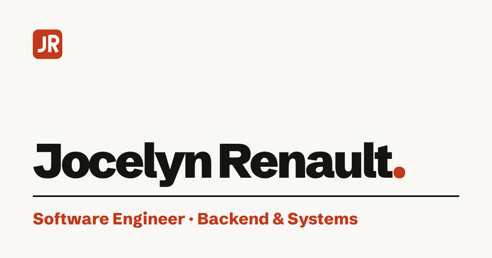

# Jocelyn Renault - Portfolio

My personal portfolio, live at **[jocelynrenault.com](https://jocelynrenault.com)**.

[](https://jocelynrenault.com)

## Stack

- [SvelteKit](https://svelte.dev/docs/kit) with Svelte 5 (runes), TypeScript
- Fully static (`adapter-static`): every page is prerendered, no backend
- English and French, dark and light themes; works without JavaScript
- Tested with Vitest; every PR runs lint, type check, tests, an accessibility audit (axe) and Lighthouse in CI
- Deployed over SFTP to OVH hosting by GitHub Actions on each merge to `master`

## Run it locally

Requires Node 24 or later.

```sh
npm install
npm run dev      # dev server
npm test         # unit tests
npm run check    # type check
npm run build    # static site in build/, then `npm run preview`
```

Other scripts:

- `npm run audit` - accessibility and Lighthouse checks on the built site
- `npm run screens` - screenshot baseline; `npm run screens -- --compare` after a change
- `npm run og` - regenerates the share images and icons
- `npm run budget` - build size budget (80 MB)
- `npm run deploy` - SFTP deploy (normally done by CI)
- `npm run smoke` - checks the live site

## Layout

- `src/lib/data/` - content: projects, skills, experience, profile (`{ en, fr }` text)
- `src/lib/i18n/` - UI text in both languages
- `src/lib/components/` - Svelte components (they only render the data)
- `src/routes/` - pages, sitemap, robots.txt
- `scripts/` - audit, screenshots, share images, deploy
- `static/` - CV, photo, project media, `.htaccess`

## Docs

- [Editing content](docs/content-guide.md)
- [Deployment](docs/deploy.md)
- [Known issues](docs/backlog.md)
- [Design spec](docs/superpowers/specs/2026-09-23-portfolio-design.md)
