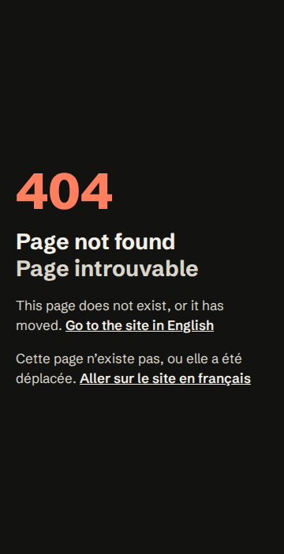
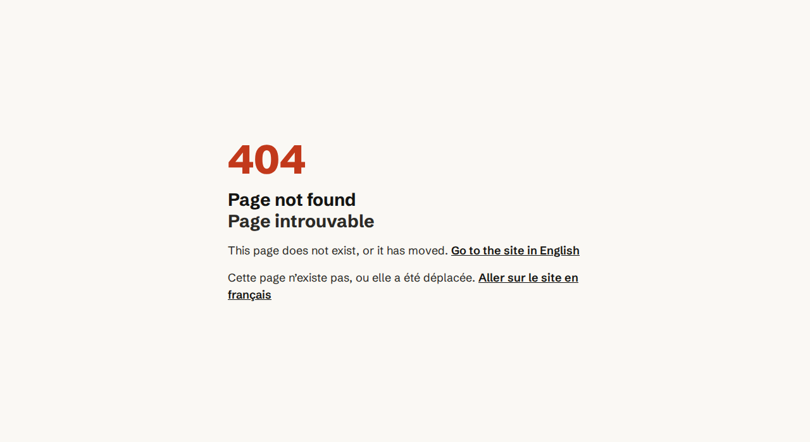

# Milestone 13 - Deployment: review guide

Spec: `docs/superpowers/specs/2026-09-23-portfolio-design.md`, section "Milestone 13 - Deployment". Plan: `docs/superpowers/plans/2026-10-15-milestone-13-deployment.md`. How deploys work from now on: [`docs/deploy.md`](../deploy.md).

**The site looks the same** (25-capture screenshot comparison identical after every task). What's new is under the hood (SEO, server config, speed, CI, deploy) plus one new page: the 404.

**Merging this PR is the first deploy.** Do the [merge checklist](#merge-checklist) first.

## Results

| | Before (3 runs) | After (3 runs) |
|---|---|---|
| Lighthouse mobile performance | 93 / 94 / 93 | **97 / 97 / 97** |
| Mobile FCP / LCP | 2.1 s / 2.7–2.9 s | 1.8 s / 2.3–2.4 s |
| Lighthouse desktop performance | 100 | 100 |
| Lighthouse SEO | 92 ("pending domain": hreflang) | **100**, nothing pending |
| Page JS (gzipped) | 65 KB | 31 KB |
| `/en/` HTML (gzipped) | 56 KB | 25 KB |
| axe, 360px overflow | 0 violations, fits | 0 violations (now also the 404 page), fits |

### How performance got there

| Try | Mobile | Outcome |
|---|---|---|
| Inline the CSS into each page | 94 / 94 / 94 | kept |
| No font preload | 96 / 94 / 94, but FCP 2.3 s and a layout shift (CLS 0.025) | dropped |
| LCP element (the hero name) | plain text, nothing waiting on it | nothing to change |
| Measured (Lighthouse with files blocked): no images 95, no JS 98, no page chunk 97–98 | | the page chunk is the lever |
| Inside the chunk: skill logo drawings ~31 KB of 65 KB, the other language only ~5–10 KB | | |
| **Skill logos into one SVG sprite** (your choice A) | **97 / 97 / 97** | kept; the language split (B) was not needed |

## What to look at

1. **404 page** (new): `npm run build && npm run preview`, then http://localhost:4173/404.html. Both languages, links to `/en/` and `/fr/`, both themes.

   | | |
   |---|---|
   |  |  |

2. **Skills section:** the logos look exactly as before (they are now drawn from `/skill-logos.svg`). Switch the language with the header link: logos still there.
3. **Page source of `/en/`:** `<link rel="canonical" href="https://jocelynrenault.com/en/">`, three absolute `hreflang` links (en, fr, x-default), absolute `og:url` and `og:image`.
4. `build/sitemap.xml`, `build/robots.txt` (with the `Sitemap:` line), `build/.htaccess`.

## Commit by commit

| Commit | What changed |
|---|---|
| `ced76de` | The audit also saves Lighthouse's JSON (used to diagnose performance). |
| `b012893` | **One site origin.** `src/lib/site.ts` holds `https://jocelynrenault.com`; canonical, hreflang (+ x-default), `og:url`, `og:image` are absolute; generated `sitemap.xml` and `robots.txt`. Asset paths are absolute (`paths.relative: false`). The audit's "pending domain" exception is gone. |
| `d9a91ea` | **404 page**, bilingual, no JS, `noindex`, works at any depth. |
| `f3ac7b6` | **`.htaccess`:** `http`/`www` → `https://jocelynrenault.com` (one 301), `/` → `/fr/` or `/en/` by browser language (302, same choice as the JS redirect, tested on 11 header shapes), caching (1 year for hashed files, HTML revalidated), gzip, security headers, deploy manifest hidden. Checked in a real Apache 2.4 (Docker), which caught two bugs before commit. |
| `af162b1` | CSS inlined into the pages. |
| `53b720e` | **Deploy tooling:** `npm run budget` (80 MB), `npm run deploy` (FTP at first, SFTP since setup, see below; only changed files, assets → `.htaccess` → pages, deletes last, never `.ovhconfig`; `--dry-run`), `npm run smoke` (live checks). The deploy ran against a local FTP server: first upload byte-identical, second run uploads nothing, a stale file deleted, a missing file sent again. |
| `6d673e4` | **CI** (`checks` on every PR and push to `master`: lint, check, test, build, budget, audit with performance report-only) and **Deploy** (after CI passes on `master`, or by hand from `master`). |
| `58b1080` | **Skill logos sprite:** the drawings leave the page JS and HTML for `/skill-logos.svg` (versioned URL, cached); `+page.server.ts` sends each logo's id and colour. Editing skills is unchanged. |
| `c127730` | Docs: `docs/deploy.md`, CLAUDE.md, README, content guide, watch list. |

## Found during OVH setup

- **The hosting refuses FTPS** ("500 This security scheme is not implemented") but accepts **SFTP** with the same login, so the deploy now uses SFTP (`ssh2-sftp-client` instead of `basic-ftp`); the password stays encrypted. It is only sent to a server holding OVH's pinned host key, checked against the key your own `sftp` accepted. Same secrets, same plan logic. Re-checked on a local SFTP server: first deploy byte-identical (a placeholder deleted, `.ovhconfig` kept), second run sends nothing, a truncated file sent again, the dry run changes nothing, a wrong host key refused before login.
- The CI audit timed out on GitHub (vite colours its URL when `CI` is set): fixed in `scripts/preview.ts`, with a test.

## Merge checklist

In this order (details in [`docs/deploy.md`](../deploy.md)):

1. **OVH setup** (§ One-time OVH setup): multisite `www` with SSL, Let's Encrypt active, DNS records, FTP password.
2. **GitHub secrets** `FTP_HOST`, `FTP_USER`, `FTP_PASSWORD` (`gh secret set …`).
3. **Dry run from your machine:** `.env.deploy` with the same three values, then `npm run build && npm run deploy -- --dry-run`. Read the delete list: it should only name OVH's placeholder files (e.g. its default `index.html` is overwritten, not deleted).
4. **Branch protection** (Claude sets it with `gh api` once you say so, see § Branch protection).
5. **Merge the PR.** Watch *Actions*: CI on `master`, then Deploy (its last step is the smoke check).
6. **Open https://jocelynrenault.com**, both languages, phone and desktop; paste the URL in a LinkedIn or Slack draft to see the preview card.
7. **PageSpeed Insights** on https://jocelynrenault.com/en/ (mobile and desktop): send Claude the scores for this guide.

## Rulings made during the build

- Task 1: `paths.relative: false` moved forward from Task 2: with relative paths `base` is `..` while prerendering, which gave `https://jocelynrenault.com../en/`.
- Task 2: the French 404 title sits on its own line (an inline " · " separator lost its spaces).
- Task 3: the host capture ignores a `:port`, and the language redirect targets `https://%{HTTP_HOST}/…` (a relative target became `http://` behind OVH's TLS proxy, one extra redirect). Found in the Apache container.
- Task 4: with your approval, the skill logos sprite instead of the language split (it was 3–4× more of the weight).
- Task 5: `FTP_PORT` added to the deploy, to test against the local FTP container. The smoke check looks for a hashed `.js` only (CSS is inlined now).
- Task 6: GitHub Actions pinned to their current majors (`v7`).

## Final review

A fresh reviewer (Opus) read the whole branch. 0 Critical. Fixed (each with a test that failed first, suite 284/284):

- **An interrupted deploy followed by a rollback could leave pages pointing at deleted JS** (the old manifest no longer described the server). The deploy now removes the manifest before uploading and also compares file sizes with the server. Re-checked on the local FTP server: a file of another size is sent again; with the manifest gone, everything is sent and the server ends byte-identical to `build/`.
- **The CVs were cached for a week** (an updated CV could reach a returning recruiter late): PDFs now revalidate on every visit, like the pages.

After merging `master` (project order and the portfolio project's images): the new order puts a 1st-place hackathon chip on a big desktop card, and in light theme its text was 4.33:1 on its tint (axe needs 4.5). The chip text now mixes 8% of the text colour into the accent: 4.84:1, barely visible. Audit all PASS again (mobile performance 96).

Deferred minors (on `docs/backlog.md`): `/en` without the slash takes an extra http hop; old hashed chunks deleted at once; empty remote folders stay; the server config assumes the domain root; Accept-Language differences on malformed headers.
