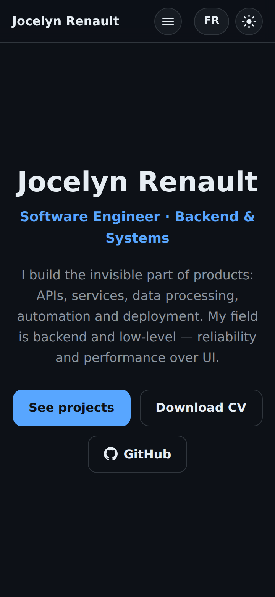
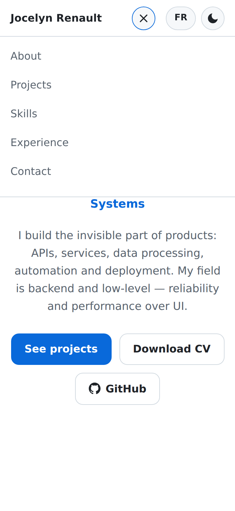
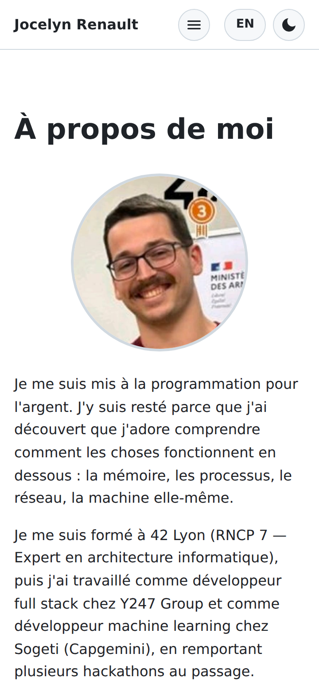
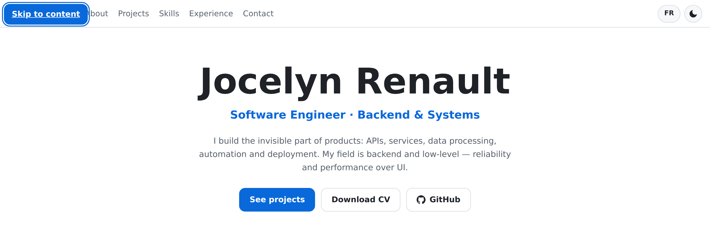
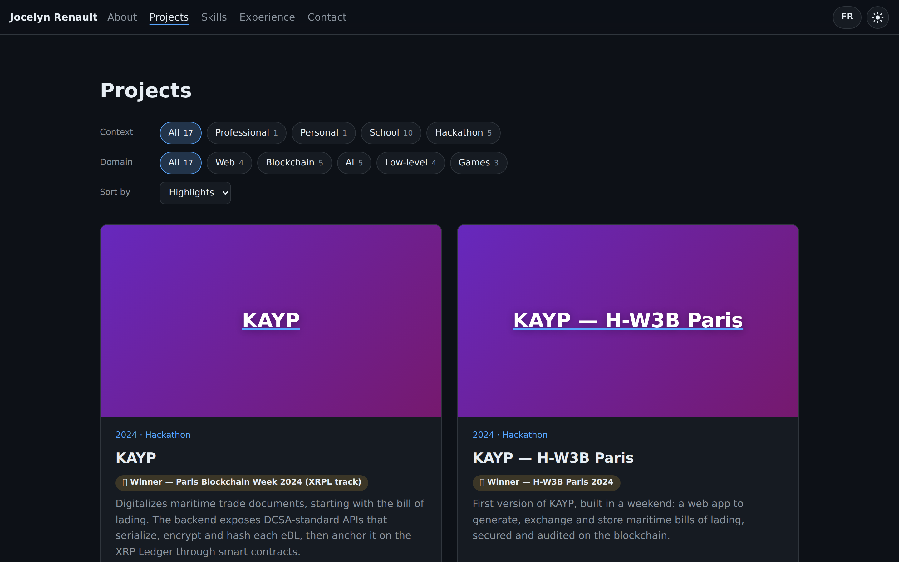

# How to review the Milestone 7 PR (Fixes & accessibility)

Branch `milestone-7-fixes-a11y` → `master`. See the PR link on GitHub for the number.

The review has three parts, in this order:

1. **Automated checks** (3 min), including the new `npm run audit`
2. **Manual testing on a real phone and a real browser** (15 min). I already drove the built site with headless Chromium: menu, Escape, Tab-out, rotation, skip link, live OS theme switch, `/` redirect by browser language, copy fallback, touch target sizes, and 20 full-page screenshots (EN/FR × dark/light × 360/390/768/1024/1440px). What I can't do is use a real phone, a real screen reader or your OS theme switch, so those are the checks below.
3. **Code review** (10 min)

Source of truth: the "Milestone 7 - Fixes & accessibility" section of `docs/superpowers/specs/2026-09-23-portfolio-design.md`, together with `docs/superpowers/plans/2026-10-01-milestone-7-fixes-a11y.md`.

This milestone is the first half of the old "Polish" milestone. Visual polish & SEO is **M8**, deployment (OVH domain, home server) is **M9**.

---

## 0. Get the code

```bash
cd /home/lezard/portfolio/.claude/worktrees/milestone-7-fixes-a11y
npm install
```

(Alternative from any clone: `gh pr checkout <PR number>`.)

| Commit | Plan task |
|---|---|
| `docs: settle Milestone 7 fixes and accessibility design` | spec |
| `docs: add Milestone 7 plan; note plan-time spec adjustments` | plan |
| `feat: collapse nav links behind a menu button on small screens` | Task 1 |
| `feat: highlight the section in view in the nav` | Task 2 |
| `fix: follow OS theme changes live and label the toggle from first paint` | Task 3 |
| `feat: add a skip link, keep list semantics and mark up dates with time` | Task 4 |
| `feat: redirect / to the visitor's language before first paint` | Task 5 |
| `fix: use no-break spaces before French punctuation` | Task 6 |
| `fix: fold in deferred review minors` | Task 7 |
| `feat: add npm run audit (axe, overflow and Lighthouse)` | Task 8 |
| `fix: run Lighthouse on Playwright's Chromium instead of chrome-launcher` | Task 9 (see calls below) |
| `fix: readable project count on the active filter chip` | Task 9 (the only audit finding) |
| `chore: ignore .svelte-kit at any depth` | final review |
| `fix: close the mobile menu when keyboard focus leaves it` | final review |
| `fix: make the audit fail when its preview server cannot start` | final review |
| `docs: domain-bound SEO checks belong to M9 in the spec` | final review |
| `docs: add Milestone 7 review guide` | this file |

## 1. Automated checks

```bash
npm run check && npm test && npm run lint && npm run build
npm run audit          # ~30 s; add `-- --screens` for screenshots in reports/screens/
```

Expected: 0 errors/warnings, **177 tests** pass, lint clean, build writes `build/`, and the audit prints 25 PASS lines and exits 0.

Careful: it's `npm run audit`. Plain `npm audit` is npm's own security audit.

Audit before the fixes in Task 9 (first run):

```
FAIL  axe … (all 13 runs)                    color-contrast (2)
PASS  no horizontal scroll … (4 runs)        fits
PASS  Lighthouse mobile performance          99
FAIL  Lighthouse mobile accessibility        97 < 100
PASS  Lighthouse mobile best-practices       100
PASS  Lighthouse mobile seo                  92 (pending domain: hreflang)
PASS  Lighthouse desktop performance         100
FAIL  Lighthouse desktop accessibility       97 < 100
PASS  Lighthouse desktop best-practices      100
PASS  Lighthouse desktop seo                 92 (pending domain: hreflang)
```

The only finding was the small project count inside the **active** filter chip (grey on the blue-tinted background, 4.1:1 instead of 4.5:1). After the fix:

```
PASS  axe /en/ dark 360px                    0 violations
PASS  no horizontal scroll /en/ dark 360px   fits
PASS  axe /en/ dark 360px menu open          0 violations
PASS  axe /en/ dark 1280px                   0 violations
PASS  axe /en/ light 360px                   0 violations
PASS  no horizontal scroll /en/ light 360px  fits
PASS  axe /en/ light 360px menu open         0 violations
PASS  axe /en/ light 1280px                  0 violations
PASS  axe /fr/ dark 360px                    0 violations
PASS  no horizontal scroll /fr/ dark 360px   fits
PASS  axe /fr/ dark 360px menu open          0 violations
PASS  axe /fr/ dark 1280px                   0 violations
PASS  axe /fr/ light 360px                   0 violations
PASS  no horizontal scroll /fr/ light 360px  fits
PASS  axe /fr/ light 360px menu open         0 violations
PASS  axe /fr/ light 1280px                  0 violations
PASS  axe /en/ before hydration light 360px  0 violations
PASS  Lighthouse mobile performance          98
PASS  Lighthouse mobile accessibility        100
PASS  Lighthouse mobile best-practices       100
PASS  Lighthouse mobile seo                  92 (pending domain: hreflang)
PASS  Lighthouse desktop performance         100
PASS  Lighthouse desktop accessibility       100
PASS  Lighthouse desktop best-practices      100
PASS  Lighthouse desktop seo                 92 (pending domain: hreflang)
```

**SEO 92 is expected until M9.** Lighthouse wants absolute `hreflang` URLs (`https://your-domain/en/`), which need the real domain. The audit reports it as "pending domain" instead of failing, and only for that one audit (and `canonical`); any other SEO problem still fails.

## 2. Manual testing

```bash
npm run preview    # http://localhost:4173
```

To try it on your phone on the same Wi-Fi: `npm run preview -- --host`, then open the "Network" URL it prints.

### Screenshots

| | |
|---|---|
|  |  |
| 360px, dark: brand, ☰, FR, theme | 360px, light, menu open |
|  |  |
| French: "dessous : la mémoire" never breaks before the colon | First Tab shows "Skip to content" |


*1440px: the nav underlines the section in view (Projects).*

The empty boxes in place of 🎓 🥇 in my screenshots are only missing emoji fonts in headless Chromium; a real browser shows the emoji.

### On a phone (or DevTools at under 760px)

- [ ] The bar shows **Jocelyn Renault**, ☰, FR/EN and the theme button, with no links row.
- [ ] ☰ opens a panel with the five links stacked; the icon turns into ✕.
- [ ] Tapping a link closes the panel and scrolls to the section. Tapping outside the panel closes it.
- [ ] Open the menu, then **rotate to landscape** (or widen past 760px): the panel closes and the links come back inline.
- [ ] Filter chips, the theme/menu/language buttons, the GitHub/demo icons and the Copy button are easy to hit (44px on touch screens).
- [ ] Nothing scrolls sideways, in both languages.

### Keyboard (desktop, then narrow the window under 760px)

- [ ] First **Tab** shows "Skip to content" top-left. **Enter** skips the nav; the next Tab lands on "See projects".
- [ ] Narrow window: Tab to ☰, **Enter** opens it, **Escape** closes it and focus stays on ☰.
- [ ] Open the menu and keep pressing **Tab** past the links, FR and the theme button: once focus moves into the page, the panel closes (final-review fix).

### Nav highlight and language switch

- [ ] Scrolling down underlines the current section in the nav (accent colour). At the very top (hero) nothing is underlined; at the very bottom, Contact is.
- [ ] Switching language from the middle of a section still lands on that section (it now uses the same rule as the highlight).
- [ ] **Alt+click** (or Ctrl/⌘/Shift+click) on FR/EN behaves like a normal link click in your browser (new tab, download, …) instead of the in-page switch.

### Theme

- [ ] **Without ever clicking the theme button** (or after `localStorage.removeItem('theme')` in the console): switch your OS between dark and light while the page is open. The page follows without reloading.
- [ ] Click the theme button, then switch the OS theme again: your choice stays.
- [ ] With a screen reader (Orca, NVDA or VoiceOver): the theme button reads "Switch to light theme" on dark and "Switch to dark theme" on light, including straight after the page loads on a light OS.

### `/` redirect

- [ ] Open `http://localhost:4173/` with a French browser language: you land on `/fr/` with no visible flash. With English or any other language: `/en/`.
- [ ] The tab title on `/` (visible for a split second, or with JavaScript disabled) is "Jocelyn Renault - Software Engineer".

### French typography (`/fr/`)

- [ ] No line starts with `:`, `;`, `!`, `?`, `%` or `»`, at any width. Examples: "produits : APIs", "125 %", « méfiez-vous des apparences ».

### Copy email (Contact)

- [ ] Copy works and shows *Copied!*. With a screen reader, a second Copy is announced again (see deferred minors: I couldn't check this with a real screen reader).
- [ ] On plain `http://` over the LAN (`npm run preview -- --host`, then open it from your phone), the clipboard API is unavailable: Copy selects the address and shows "Press Ctrl+C (⌘C on Mac) to copy." under the tile.

## 3. Code review

Calls I made during the build (please confirm):

- **Before-hydration check instead of no-JS.** axe has to inject JavaScript, so it can't run with JavaScript fully disabled. The audit checks the prerendered page with the app bundles blocked instead, which is what a visitor on a slow phone sees before the site loads. I also checked with JavaScript fully off that the links stay reachable and the theme button has exactly one correct label.
- **Lighthouse runs on Playwright's Chromium.** The plan used `chrome-launcher`, but under WSL it converts paths to Windows ones and created stray `C:\Users\…` folders in the repo. Lighthouse now attaches to Playwright's own Chromium through a debugging port (9223); `chrome-launcher` was removed.
- **Branch history was cleaned before the first push.** One Task 7 command accidentally committed 16 generated SvelteKit files (`src/.svelte-kit/`, `src/lib/.svelte-kit/`), including a list of environment-variable *names* from my shell. Nothing had been pushed, so I removed them from the branch history (not just in a later commit), and `.gitignore` now ignores `.svelte-kit` at any depth.
- **Skill-icon trimming dropped** (agreed in the spec): the bundle keeps whole `simple-icons` objects whatever fields are read.
- **Medal labels carry their colon** (`'1re place :'`) so French gets its no-break space.

Code:

- `src/lib/nav-menu.ts`: `nextMenu(open, event)`, the menu rules (Escape returns focus only when it closed the menu). `Nav.svelte` wires toggle / Escape / link / outside / focus-out / widen to it.
- `src/lib/sections-dom.ts`: `currentSection()`, the one "which section is on screen" rule shared by the nav highlight and the language switch.
- `src/lib/theme.ts`: `themeOnSystemChange(stored, prefersDark)`. `ThemeToggle.svelte` labels itself with two hidden spans, one shown per theme by CSS, like the sun/moon icons.
- `src/lib/experience.ts`: `periodPoints()` feeds `<time datetime>` (new `experience/Period.svelte`); `formatPeriod` is built on it, same output.
- `src/lib/i18n/redirect.ts`: the inline `/` redirect script. `redirect.spec.ts` runs it against `pickLang` for several browser language lists and under a sub-path, so the two copies can't drift; `<` is escaped so nothing can close the `<script>` tag.
- `src/lib/i18n/typography.ts` + `typography.spec.ts`: every French string in the dictionary and data files must use a no-break space before `: ; ! ? %` and inside « ».
- `src/app.css`: new tokens `--tap` (2.25rem, 2.75rem on touch screens), `--pill` (1.25rem), `--ok` (availability dot), the skip link.
- `scripts/audit-report.ts` (pure, tested) + `scripts/audit.ts` (runner). Reports go to `reports/` (git-ignored).

Final review (an independent reviewer on the whole branch): 0 Critical. The 3 Important findings were fixed (accidental generated files, menu staying open after Tab-out, audit possibly auditing another server already on its port), and the spec's "carried to M8" became M9.

Left for later (final-review minors):

- The CSS breakpoint (`max-width: 47.49rem`) and the JS one (`min-width: 47.5rem`) leave a sub-pixel gap at odd zoom levels.
- Narrowing the window while focus is on an inline nav link sends focus to the page body.
- The repeat "Copied!" announcement clears and refills the live region one frame apart; some screen readers may merge it (a ~100 ms delay is more reliable). Worth checking with a real screen reader.
- `--pill` (20px) makes a full pill only up to 40px tall, so the 44px touch controls get slightly squared ends.
- `scripts/*.ts` aren't type-checked by `npm run check`, and `package.json` has no `engines` field for the Node ≥ 22.18 the audit needs.

Moved to **M8 (visual polish & SEO):** scroll-reveal animations, favicon, OG image and per-language meta, project screenshots as card media.
Moved to **M9 (deployment):** OVH domain, home-server hosting, absolute canonical/hreflang/OG URLs (that's when SEO reaches 100).
