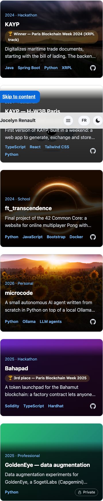
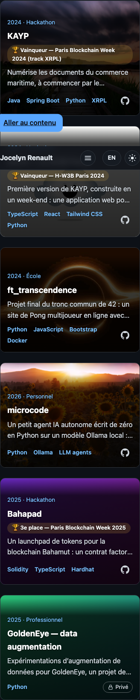
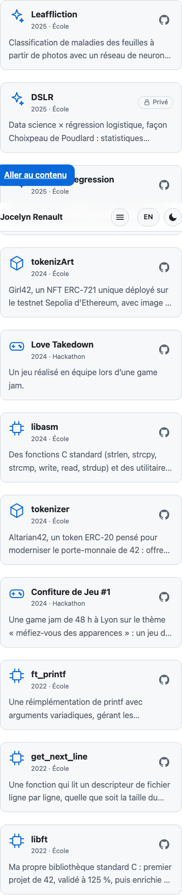
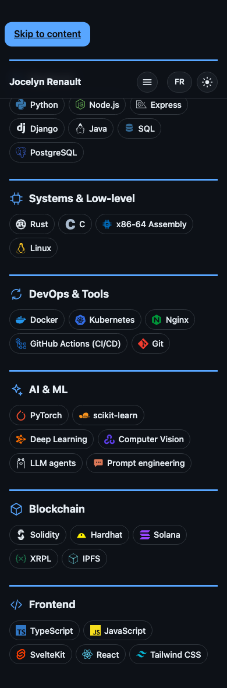
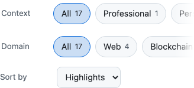
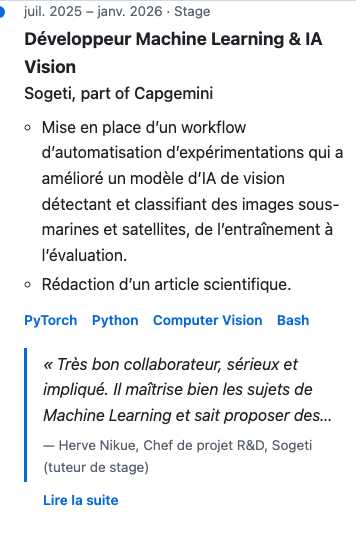
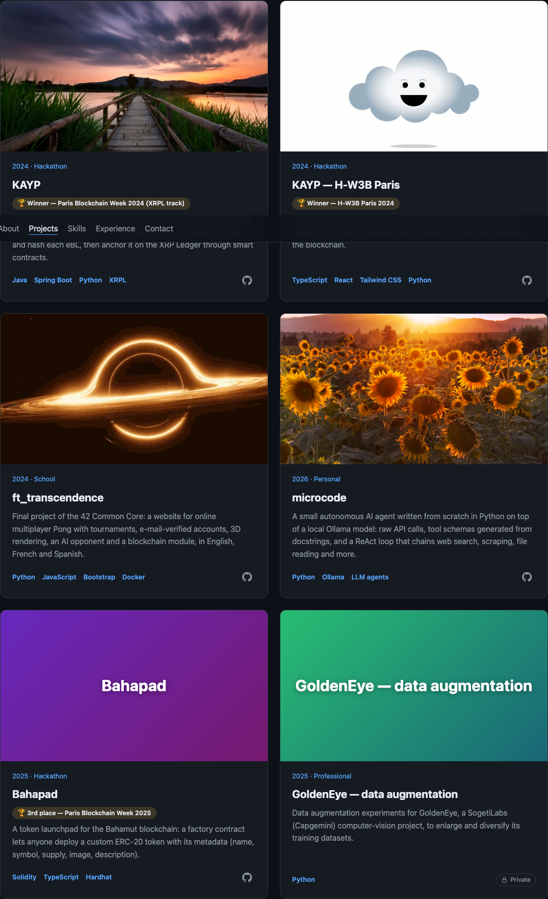

# How to review the Milestone 8 PR (Layout & media)

Branch `milestone-8-layout-media` → `master`. See the PR link on GitHub for the number.

The review has three parts, in this order:

1. **Automated checks** (3 min)
2. **Manual testing on a real phone and a real browser** (15 min). I already drove the built site with headless Chromium at 360, 390, 768, 1024 and 1440px, both themes and both languages, with temporary test media in place. What I can't do is hold a real phone, judge the overlay over your own screenshots, or use Safari.
3. **Code review** (10 min)

Source of truth: the "Milestone 8 — Layout & media" section of `docs/superpowers/specs/2026-09-23-portfolio-design.md`, together with `docs/superpowers/plans/2026-10-02-milestone-8-layout-media.md`.

The old "Visual polish & SEO" milestone is now split: **M8 Layout & media** (this one), **M9 Finishing touches & SEO** (hero accent, section-heading accent, scroll-reveal, favicon, OG image, per-language meta), **M10 Deployment**.

---

## 0. Get the code

```bash
cd /Users/lezard/Documents/portfolio/.claude/worktrees/milestone-8-layout-media
source ~/.nvm/nvm.sh && nvm use 24     # this Mac's default Node may be 23.10, which npm ci rejects
npm ci
```

(Alternative from any clone: `gh pr checkout <PR number>`.)

| Commit | Plan task |
|---|---|
| `docs: settle Milestone 8 layout and media design` | spec |
| `docs: add Milestone 8 plan` | plan |
| `feat: type project media as image or MP4 video with a poster` | Task 1 |
| `feat: show the poster first and add the video only when it should play` | Task 2 |
| `feat: overlay large project cards on phones, lift them on hover` | Task 3 |
| `feat: compact project rows and one-row filters on phones` | Task 4 |
| `feat: tighter sections and skill chips on phones` | Task 5 |
| `feat: clamp long recommendation quotes on one-column layouts` | Task 6 |
| `fix: use typographic apostrophes in French text` | Task 7 |
| `fix: keep a keyboard-focused filter chip clear of the label and the fade` | final review |
| `fix: keep phone overlay text at 4.5:1 even over a white image` | final review |
| `fix: fail the media test on a path whose case differs from the file` | final review |
| `docs: add Milestone 8 review guide` | this file |

Task 8 (checks with temporary media) has no commit of its own: its screenshots are in `docs/reviews/milestone-8/`.

## 1. Automated checks

```bash
npm run check && npm test && npm run lint && npm run build
npm run audit
```

Expected: 0 errors/warnings, **205 tests** pass, lint clean, and the audit prints 25 PASS lines and exits 0 (same table as M7: axe 0 violations everywhere, no horizontal scroll at 360px, Lighthouse mobile performance 98 / desktop 100, accessibility and best practices 100, SEO 92 "pending domain" until M10). It also passed with the temporary test media in place.

### Page heights, before → after

Measured with the same four projects showing media (EN; FR is within ~2%).

| | Phone (390px) | Desktop (1440px) |
|---|---|---|
| **Whole page** | 13,600 → **9,368** | 7,450 → **6,920** |
| Projects | 7,263 → **3,873** | 3,479 → 3,479 |
| Experience | 2,248 → **2,028** | 1,097 → 1,071 |
| Skills | 1,609 → **1,180** | 817 → 714 |
| About | 899 → **811** | 540 → 470 |

The spec estimated "under ~9,000px" on phones; it lands at ~9,400. Large cards went from ~600px to ~250–270px, small cards from ~300px to 137px, the filters to 148px. Experience barely moved, see "Calls I made" below.

## 2. Manual testing

```bash
npm run preview    # http://localhost:4173
```

To try it on your phone on the same Wi-Fi: `npm run preview -- --host`, then open the "Network" URL it prints.

### Screenshots (with temporary test media)

These use your test images and GIFs from `tmp/`, converted to MP4 for the occasion. **None of that media is committed**: the repository still has no project media, so the real site shows the coloured placeholders until you add yours.

| | |
|---|---|
|  |  |
| 390px, light: image or poster behind a translucent dark overlay | 360px, dark, French: KAYP's long award wraps and the card grows |
|  |  |
| "More projects" as compact rows | Smaller skill chips |
|  |  |
| One row of chips per filter group, faded right edge | Quote cut to 3 lines with « Lire la suite » |


*1440px: media on top as before; the two video cards (cloud, black hole) are videos, loaded because they are on screen at desktop width.*

The nav bar and "Skip to content" across the middle of some captures are a screenshot artifact (element screenshots of a page with a fixed nav).

### Add your real media (and check it)

1. Put the files in `static/projects/`: an image (`.jpg`, `.jpeg`, `.png` or `.webp`), or an `.mp4` video **plus** a still image for it.
2. To grab the poster from a video:
   ```bash
   ffmpeg -i static/projects/name.mp4 -frames:v 1 -q:v 3 static/projects/name.jpg
   ```
   (To start from a GIF instead: `ffmpeg -i name.gif -movflags +faststart -pix_fmt yuv420p -vf "scale=trunc(iw/2)*2:trunc(ih/2)*2" -c:v libx264 -crf 26 -an static/projects/name.mp4`. Your 1.6 MB test GIF became a 34 KB MP4.)
3. In `src/lib/data/projects.ts`, on the project:
   ```ts
   media: { kind: 'video', src: 'projects/name.mp4', poster: 'projects/name.jpg' },
   // or
   media: { kind: 'image', src: 'projects/name.jpg' },
   ```
4. `npm test` fails, naming the file, if a format is wrong, the poster is missing, a path starts with `/`, or a file doesn't exist.

### On a phone (or DevTools under 768px)

- [ ] The six large project cards show the image (or the coloured placeholder) behind the text, about a third of the old height. Text is readable over **your** images, including bright ones.
- [ ] Video projects show their still poster on the phone and never play. (In DevTools → Network, filter on `mp4`: nothing at phone width.)
- [ ] "More projects" are compact rows: icon, title, year · context (🏆 for award winners), links on the right, two lines of description.
- [ ] Each filter group is one row you can swipe sideways; the label stays put, the right edge fades. The page itself never scrolls sideways.
- [ ] Sections are closer together; skill chips are smaller.
- [ ] Under Experience, each quote shows 3 lines and « Lire la suite » / "Read more"; it expands and collapses.

### Desktop with a mouse

- [ ] Hovering a large card lifts it slightly, gives it a blue border and gently zooms its image. Small cards lift a little less, with no zoom.
- [ ] Tabbing onto a card's link gives the same effect (keyboard users).
- [ ] A video card starts playing as it scrolls in and pauses when it leaves. (Real media needed; or redo the temporary setup from Task 8 of the plan.)
- [ ] Turn on **System Settings → Accessibility → Display → Reduce motion**: videos no longer play (poster only), cards don't lift or zoom (border colour only).
- [ ] Try a video in **Safari**.
- [ ] At 900px and wider, quotes are shown in full with no button.

## 3. Code review

Calls I made during the build (please confirm):

- **Overlay darkness: 75% black where the text starts, 85% at the bottom.** The plan's 78–90% hid the picture almost entirely, so during the build I lightened it to 65–80%. The final review then showed the blue "2024 · Hackathon" line falls to 3.6:1 over a white screenshot at 65%. 75% is the lightest that keeps every overlay colour at 4.5:1 or more even over pure white. `src/lib/overlay.ts` holds the values and a test checks both the contrast and that the CSS matches.
- **Filter rows on phones:** the label now has a fixed width, and a focused chip is scrolled fully into view, clear of both the label and the faded edge (`scrollIntoView` on focus + scroll padding). Without it, Shift+Tab could leave a chip hidden under the label.
- **The quote clamp saves almost nothing with today's quotes.** They are 4–5 lines on a phone, so cutting them to 3 saves 25–50px, and the "Read more" button adds about 44px back. I built it as specified because it works and will help if a longer recommendation is ever added, but if you'd rather drop it (or only clamp quotes over 5 lines), it's a one-line change in `quoteView`.
- **Review screenshots are section crops** from my own Playwright run, not the audit's full-page shots (9,000px tall and unreadable at a glance).
- The `wip-m8-handoff` branch was deleted (locally and on GitHub), and the main checkout is back on `master`.

Code:

- `src/lib/projects.ts`: `Media` (image, or MP4 video with a required poster), `DESKTOP_QUERY`, `shouldPlayVideo()`, `mediaIssues()` (formats, relative paths, missing files; used by `data/projects.spec.ts`).
- `src/lib/components/projects/ProjectMedia.svelte`: always an `` (picture or poster, lazy). The `<video>` is inserted the first time `shouldPlayVideo` is true (desktop via `MediaQuery`, in view via `IntersectionObserver`, no reduced motion) and then stays, paused when off-screen. `MediaQuery` is false on the server, so the prerendered HTML has no `<video>` at all.
- `ProjectCardLarge.svelte` / `ProjectCardSmall.svelte` / `ProjectFilters.svelte`: phone layouts are pure CSS under `@media (width < 48rem)`; the overlay redefines `--text`, `--muted`, `--accent`, `--border` locally so links, tags and the Private pill stay readable on the dark gradient in both themes. The small card's 🏆 + hidden award text only exists on phones (`display: none` elsewhere), so the award is never read twice.
- `src/lib/experience.ts`: `quoteView()` and `ONE_COLUMN_QUERY`. `JobItem.svelte` measures overflow with a `ResizeObserver` and only clamps after hydration.
- `src/lib/i18n/typography.ts`: `straightApostrophes()`; `typography.spec.ts` now also fails on a straight `'` in any French string. It found 10, all in the profile text.
- `Section.svelte`: no more `min-height: 60vh`; smaller padding and heading on phones. `Projects.svelte`: its phone breakpoint is now `width < 48rem`, so 768px is "desktop" everywhere.

Final review (an independent reviewer on the whole branch): 0 Critical. Fixed, each with a check that failed first:

- A keyboard-focused filter chip could hide under the sticky label or in the faded edge (15 positions in EN/FR at 360px → 0).
- Overlay meta line under 4.5:1 over bright images (see above).
- A media path whose case differs from the file passed on macOS but would 404 on the Linux server; the media test now compares names exactly (I raised this one from minor because you're about to add media and deploy to Linux).

Left for later (final-review minors):

- If a quote is expanded and the window is then widened until it would fit in 3 lines (or past 900px) while the button has focus, "Show less" can stay for nothing or drop focus to the page. Rare.
- On phones, only a thin strip at the top of an overlay card is a tap target for the media link (the text covers the rest). The GitHub/demo icons are the real links; worth a look with your real images.

